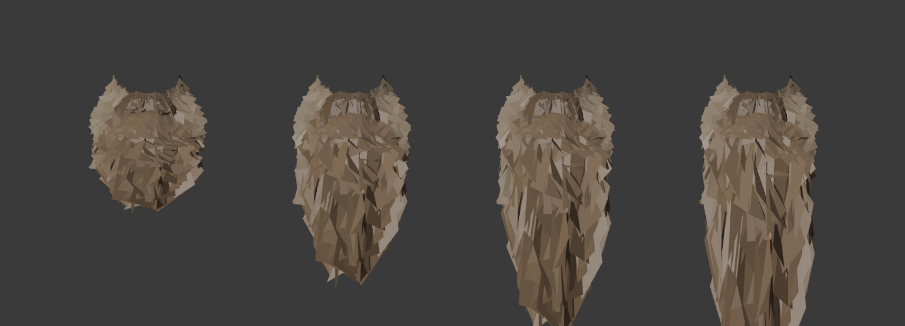

# Infinite Hair – RDR2 (Story Mode)

Arthur's hair and beard grow just like in the vanilla game, but they no longer stop at
the game's maximum: hair grows down to the belt (length 29 instead of 9, with cloth
physics), and so does the chin beard (29 instead of 10). A hotkey lets you grow them
yourself, and an optional turbo mode grows them in real time.

**Download for players:** Nexus Mods (see the release zip). This repository holds the
source code and the tools used to build the longer models.

> Story mode only. Never start Red Dead Online with script mods installed.



## How it works

RDR2 has no "hair length" native. Arthur's hair and beard are MetaPed drawables, one per
style and length:

- hair: `player_zero_hair_s04_l07_p0`: style 04, length 07, no pomade
- beard: `player_zero_beard_shv_chin_000_10`: chin beard, style 000, length 10
  (plus `…_stache_…` mustache and `…_chops_…` sideburns)

The `.asi` script (ScriptHookRDR2) reads the worn drawables
(`GET_META_PED_ASSET_GUIDS`), keeps a target length per part and swaps in the next
length with `_SET_META_PED_TAG`, keeping textures and tint.

**Growth:** in the default `natural` mode the game grows hair as usual. The mod counts
in-game time (clock natives) per part. When the game hasn't grown a part for
`HoursPerStep` in-game hours, the mod grows it one step itself. That happens at the
vanilla maximum, or with a beard stuck without hair tonic. Haircuts are accepted when
the length drops while the barber or camp mirror is active. A drop to exactly the
vanilla maximum outside of that is the game re-applying its tracked length (outfit
change, mounting), and the mod undoes it. `turbo` mode grows one step every
`GrowIntervalSeconds` real seconds instead.

**Lengths beyond the vanilla maximum** need new models, and the game ignores new
drawable names (only drawables from its own archives are accepted). So longer lengths
*borrow* existing drawables Arthur doesn't use: hair styles 07/08 (they have no cloth
files), beard styles 001 and John's beard. LML replaces those files.
`[Chains]` in `InfiniteHair.ini` maps each virtual length to its slot, e.g.
`player_zero_hair_s04_l10_p0=player_zero_hair_s08_l03_p1`.

**Hair physics:** every hair length needs its cloth file (`.yld`). Without one the
cloth-driven lower part vanishes. The generator stretches only the cloth-driven vertices
(the rest is rigidly skinned to head and neck) and adds collision capsules on the spine,
since vanilla hair only collides with head, clavicles and collar.

Research notes (German): [docs/NATIVES.md](docs/NATIVES.md).

## Project layout

```
src/                  C++ ScriptHookRDR2 plugin (InfiniteHair.asi)
  script.cpp          growth, barber lock, probing, dump/record
  groom.cpp           drawable names, length ranges, borrowed slots
  config.cpp          .ini parser, joaat, state file
  natives.h           natives called by hash (RDR3 NativeDB)
dist/                 InfiniteHair.ini (release defaults), README for the zip
lml/InfiniteHair/     LML mod folder (install.xml; stream/ holds the built models)
tools/grow_models.py  builds longer models from CodeX XML exports (+ test)
tools/make_release.py checks and zips the release
tests/                offline tests (see tests/README.md)
build.bat, test.bat   build and test with Visual Studio 2022
```

## Building the plugin

1. Visual Studio 2022 with "Desktop development with C++".
2. Download the ScriptHookRDR2 SDK from http://www.dev-c.com/rdr2/scripthookrdr2/ and
   extract it to `sdk/` (so `sdk/inc/main.h` exists). Its license doesn't allow
   redistribution, so it's not in this repo.
3. Run `build.bat` → `build/InfiniteHair.asi`. Run `test.bat` for the offline tests.

## Building the longer models

You need CodeX (by dexyfex) to convert between game files and XML.

1. **Export** (CodeX, Global Search, right click → Export XML) to `models/export/`:
   `player_zero_hair_s04_l09_p0` (`.ydd` and `.yld`) and
   `player_zero_beard_shv_{chin,chops,stache}_000_10`.
2. **Generate**, for example the 20 hair lengths:

   ```bash
   python tools/grow_models.py models/export/player_zero_hair_s04_l09_p0.ydd.xml --slots player_zero_hair_s08_l03_p1,player_zero_hair_s08_l04_p1 --out models/generated
   ```

   The script prints the `[Chains]` lines for the `.ini`. Beard parts use
   `--direction forward` (`--outward 0.1` chin, `0.5` chops, `0.3` mustache). See
   `--help` for all options.
3. **Import** the XML files with CodeX (Edit mode) into
   `<game>/lml/InfiniteHair/stream`.
4. **Release:** `python tools/make_release.py --game "<game folder>"` checks that every
   chain has its files and writes `release/InfiniteHair-<version>.zip`.

The model files are edited Rockstar assets. They're distributed as a mod on Nexus, not in
this repository.

## Known limitations

- The extra lengths are modelled on Arthur's "swept back" hairstyle without pomade. Every
  other style grows to its own maximum first and then continues in that style (e.g. after
  a short barber cut, which switches to style 01).
- Choosing hair styles 07/08 or the beard styles forked/handlebar/dundreary at the barber
  shows the long models. In the epilogue John wears the long beard.
- Beards have no physics in RDR2: very long beards follow the head rigidly.
- ScriptHookRDR2 must match the game version.

## Credits

- Alexander Blade – ScriptHookRDR2 and SDK
- LMS / Lenny – Lenny's Mod Loader
- dexyfex – CodeX
- femga – [rdr3_discoveries](https://github.com/femga/rdr3_discoveries) (drawable and bone names)
- alloc8or – [RDR3 Native DB](https://alloc8or.re/rdr3/nativedb/)
- Sollumz team – [Sollumz_RDR](https://github.com/Sollumz/Sollumz_RDR) (XML format reference)

## License

Source code: MIT, see [LICENSE](LICENSE). Red Dead Redemption 2 and its assets belong to
Rockstar Games / Take-Two Interactive.
